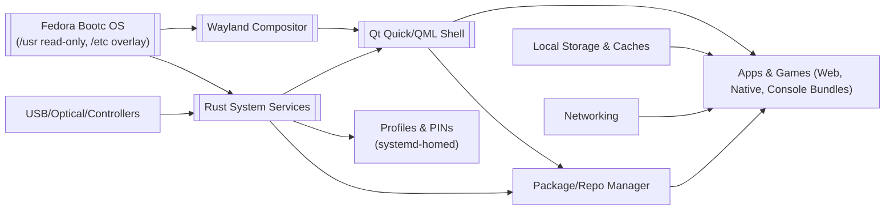
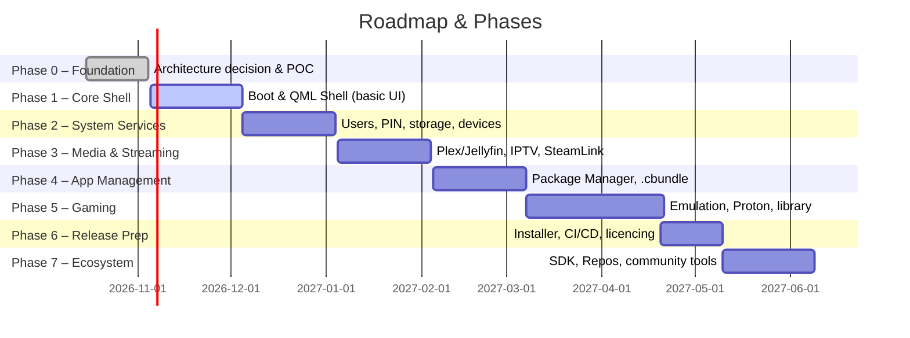

# Technical Architecture: Console-Style Linux TV OS

**Executive Summary:** Build an immutable, Fedora-bootc–based Linux OS that boots directly into a full-screen, Wayland/QML console UI.  We leverage Fedora’s container-driven (bootc) image mode for atomic updates and rollback. The UI shell will use **Qt Quick/QML** for high-performance 60 FPS animations (blur, ambient sound, etc.), running on a **Wayland** compositor. Trusted services (profiles, package management, device I/O) are implemented in Rust. Third-party apps use sandboxed runtimes (WebView or Qt App Manager), with an optional custom “Console Bundle” manifest format based on OCI/Flatpak principles. Hardware support spans basic (older Intel NUCs) to high-end PCs. The development workflow uses Windows hosts (editor/LLM) with Podman/QEMU for building and testing. 

**Implementation Checklist (Phase 0 Proof-of-Concept):**  
1. **Build a bootc image:** Use Fedora’s `fedora-bootc` base image and a Containerfile to create a custom OS image (e.g. `FROM quay.io/fedora/fedora-bootc …`). Mount `/opt` on `/var/opt` if needed.  
2. **Podman build:** On a Linux VM (Podman machine on Windows), run `podman build -t console-os:dev .` and then use the [`bootc-image-builder`](https://github.com/osbuild/bootc-image-builder) container (with `--privileged`, etc.) to produce an installable ISO or disk image.  
3. **QEMU boot test:** Boot the image in QEMU (Wayland-on-X11 mode) to verify the Linux kernel, graphics drivers and a minimal Qt Quick shell start up as the primary session.  
4. **Minimal QML shell:** Create a simple QML UI for the shell (e.g. a fullscreen Window with animated elements and blur effect) and ensure it runs atop the Wayland session. Verify 60 FPS on hardware (lower on older GPU as fallback).  
5. **Install simulation:** Use the bootable installer to install to a VM disk and then test an update/rollback cycle (applying a new image vs. restoring the old one).  
6. **Documentation:** Document the build commands, configuration (e.g. `config.toml` for bootc-image-builder), and VM setup (serial console, networking). Record any Podman/WSL issues.  

With Phase 0 validated, proceed through phased development (below). 

## System Architecture



- **Immutable Base (Fedora + bootc):** We use a Fedora-based image built via the bootc project. The container image (e.g. `quay.io/fedora/fedora-bootc`) defines `/usr` (read-only) and carries the base packages (kernel, Mesa, Qt, PipeWire, etc.).  `/etc` is overlayed (configurable), and `/var` is initialized at first boot then preserved. This OSTree-like design provides atomic, image-based updates with rollback. All OS-level software (drivers, services, Rust binaries) resides in the immutable image; updates are deployed as new images.  Only user data, logs, caches and `/home` lives on a separate volume.  

- **Wayland Compositor:** The system runs a Wayland compositor as the display server. Viable options are:  
  - **Qt Wayland Compositor:** We can build a custom compositor in QML/C++ using Qt’s [QtWayland Compositor module](https://doc.qt.io/qt-6/qtwaylandcompositor-index.html). This integrates seamlessly with our Qt Quick UI. It supports XDG Shell clients and can be tested atop X11 for development. However, writing and maintaining a compositor is significant work.  
  - **Qt Application Manager (appman):** Qt’s Application Manager provides a ready framework (under GPL/LGPL) with a QML-based system UI and lifecycle management. It acts as a Wayland compositor and launcher, including manifest and packaging tools. Using it could accelerate development of UI and app management at the cost of its GPLv3 license (business use would need a Qt license).  
  - **Existing Compositors (Weston/wlroots):** Use a lightweight compositor like **Weston** or a wlroots-based one (e.g. [wayfire](https://wayfire.org/), [labwc](https://github.com/zakarumych/labwc), or [Sway](https://swaywm.org/)). These are stable and well-tested. Weston (MIT license) is an obvious default that supports full-screen and kiosk modes. However, integrating our QML UI would require either writing a Wayland client for the shell or embedding QML surfaces, which complicates design. Labwc (MIT) is simple and can tile or float, but again lacks direct QML integration.  
  - **Comparison:** 

| Compositor Option       | Integration Ease | Graphics Support    | QML Integration | License         |
|------------------------|------------------|---------------------|-----------------|-----------------|
| **Qt Wayland Compositor** | Moderate (custom dev) | Full GPU/EGL support | Complete (we write UI directly) | GPLv3/commercial |
| **Qt App Manager**        | High (framework ready) | GPU/EGL (via Qt Wayland) | Native (has QML system UI)    | GPLv3/commercial |
| **Weston**               | Low (ready-to-run)    | Full GPU/EGL (driver support) | Limited (shell must be client) | MIT            |
| **wlroots (e.g. sway)**  | Moderate (existing)   | Full GPU/EGL            | Limited (non-Qt, tiling)      | MIT            |
| **labwc**                | Low (lightweight)     | Good (wlroots EGL)      | Limited (customization via C) | MIT            |

Each option is viable. For Phase 0 we can prototype with Weston or X11+Qt composite to verify UI functionality, then decide. (Note: Qt Wayland fallback is possible – if no EGL, it uses CPU blits, so hardware GPU is important for performance.)  

## Application and Packaging Strategy

We provide an SDK for third-party apps (news, weather, games, etc.) and a package system. Options:

- **Flatpak:** A mature sandboxed app format using OSTree. Pros: wide adoption, built-in sandbox (Bubblewrap), D-Bus/portal APIs. Cons: Desktop-centric (menus, X11 integration), may need adaptation for TV UI. Uses `.flatpak` bundles and remote repos. Likely a fallback for supporting existing Linux applications.  
- **OCI Containers:** Treat each app as a container. Can use Podman to run apps. Pros: standard container ecosystem. Cons: heavier heavyweight for desktop apps, needs wrapper for display. Not typical for end-user app installation.  
- **Qt Application Manager packages:** If using Qt AM, packages are `.ppk` (with YAML manifest). This aligns well with Qt AM’s manifest (see below).  
- **Custom “Console Bundle” (`.cbundle`):** A JSON/YAML manifest + archive that can embed artwork, metadata, and game files. Essentially a specialized wrapper: e.g. 
   ```json
   {
     "id": "com.example.game",
     "version": "1.2.3",
     "name": { "en": "Space Adventure", "de": "Weltraumabenteuer" },
     "description": { "en": "A space exploration game." },
     "icon": "space_adventure.png",
     "artwork": ["cover.jpg","screenshot1.png"],
     "dependencies": ["console/runtime-luajit:1.0"],
     "launch": { "cmd": "./space_adv", "args": ["--fullscreen"] },
     "savePath": "user_save/{id}/",
     "permissions": ["gamepad", "network"],
     "signature": { "url": "https://store.example.com/com.example.game.sig" }
   }
   ```  
   This format (like Qt AM’s `info.yaml`) would describe the app, artwork, launch command and required runtimes. The bundler/installer will validate the signature, extract files, and register the app. We would only implement this if Flatpak/QAM do not meet needs. In practice, use existing tools (Flatpak or Qt App Manager) to avoid duplicate effort. 

**Repositories/Stores:** Use a single package manager (e.g. rpm-ostree for OS; Flatpak/remotes or Podman registries for apps) with multiple repos. Types: _Official_ (curated, signed), _Community_, _Developer/Beta_, _Private_. Each repo has signed metadata and keys; users can enable/disable repos. The store UI distinguishes **trusted** (official-signed) apps from **community**/unsigned apps. 

**Sandboxing:** Use standard isolation. For Flatpak, rely on bubblewrap namespaces. For Qt AM, use its container/daemon model. We should enable filesystem and device portals for access. Do **not** run third-party apps as root. Use seccomp and Linux namespaces. Avoid inventing a new sandbox (no reimplementing Flatpak’s tech); reuse Bubblewrap or similar. 

**Manifest schema:** If we use a custom format, it will be JSON or YAML. Fields (inspired by Qt AM) include:
```
{
  "formatVersion": 1,
  "id": "com.company.app",
  "version": "x.y.z",
  "name": {"en": "App Name"},
  "description": {"en": "Long description."},
  "icon": "icon.png",
  "category": ["News", "Tools"],
  "dependencies": ["console/runtime-libqt:6"],
  "applications": [{
      "id": "com.company.app.main",
      "executable": "app_main",
      "runtime": "qml",
      "permissions": ["audio", "network"]
  }]
}
```
This maps closely to the [Qt Application Manager `info.yaml` schema】. We'll provide a JSON or YAML example in docs. 

**Acceptance Criteria (Packaging):** The OS can install/uninstall an app safely: validate signature, satisfy dependencies, show progress. Apps run in isolated processes, appear in the UI with correct icon/name, and uninstall cleans up files. Errors (missing deps, bad signature) are reported to the user.

## UI & Graphics

The console UI must be **smooth and cinematic** (PS5-like) while remaining adaptive. 

- **Qt Quick/QML Shell:** All UI pages (home, launcher, settings, store) are implemented in Qt Quick. Use **states and transitions** for page changes, `SequentialAnimation` and easing curves for motion, and `Behavior` on properties for smooth interpolation. Use Qt Quick Controls 2 for components (lists, grids), but a custom theme (dark, large elements). Animate elements at 60 FPS whenever hardware allows.  

- **Blur and Effects:** Use `ShaderEffect` for blur or Gaussian blur shaders on background panels. Example: 
  ```qml
  Rectangle { id: panel; color: "#00000080"; anchors.fill: parent }
  ShaderEffect {
      anchors.fill: parent
      fragmentShader: "/* GLSL blur code here */"
      source: panel
  }
  ```
  GPU acceleration (EGL/GL) is required for performance; configure `QT_WAYLAND_HARDWARE_INTEGRATION=wayland-egl`. On older GPUs fallback to simpler backgrounds (non-blurred) or lower-resolution blur if necessary.

- **Performance:** Aim for 60 FPS on mainstream hardware. Use `FrameAnimation` or `Behavior on ...` rather than expensive `NumberAnimation` in loops. Defer heavy tasks (e.g. loading images, indexing games) to background Rust services. We can display FPS with Qt’s `FrameTimer` (see Qt AM example). On weak hardware, allow a “Performance Mode” that disables non-essential effects.

- **Sound Design:** Include UI sound effects (navigate, select, back) and optional ambient background music. Hook sound into QML via a `SoundEffect` or `Audio` element. Volume and mute controls in Settings. Use PipeWire for system audio routing; provide a volume OSD and route game/app audio separately if needed.

- **Artwork:** Use large, high-res artwork for games and apps. Preload and cache thumbnails; show a low-res placeholder while loading. Background images (e.g. blurred game art) should update smoothly on selection change.

- **Controller Navigation:** Focus-based input. Define a focus highlight (glow or scale) for the selected item. Use `Keys.onPressed` in QML for D-pad/arrow keys. Keyboard and mouse should also work but not required for users. Ensure a controller can navigate all dialogs without a cursor.

**Acceptance Criteria (UI):** Animation must appear fluid (no jank) on target hardware. Navigate the UI entirely by controller, with focus never lost. Blur and transparency should look consistent with PS5/TV-grade UI. Sound effects should play on events. A test suite could verify frame rate under simulated load and that focus navigation works (e.g. using Qt Test QML modules).

## Audio Architecture

Use **PipeWire** (modern audio server) with **WirePlumber** or similar for policy. This handles device mixers, Bluetooth audio, and multiple streams. 

- **System Sounds:** The shell’s sound effects and ambient audio play through an application sink. Users can adjust volume via a UI slider.  
- **Game/App Audio:** Routed through PipeWire. For transparency, user can mute all background sounds when a video or game audio plays.  
- **Routing:** Implement a Pulseaudio/ALSA-compatible output. Test switching between HDMI audio, analog, Bluetooth. On a controller event (e.g. volume button), display an OSD.

**Acceptance:** Changing audio devices (e.g. plug in headset) is seamless. Volume controls work, and game/app audio plays correctly on connected output.  

## Input and Device Support

- **Controllers:** Support USB and Bluetooth gamepads (Xbox, PlayStation, generic). Use **libinput** and test with SDL or Qt’s gamepad modules. Provide a Settings UI to pair BT controllers and test all buttons. Handle hot-plugging at runtime (joining new controllers to player profiles).  
- **Keyboards/Remotes:** Basic support for navigation keys, if present.  
- **USB Storage:** Auto-detect and mount (customize rules via udev/systemd). On insert, show a notification with options (Browse Media, Install Package, Eject). Use `/mnt/media` for mounts. Supported filesystems: ext4, FAT32, NTFS (read-only if needed), exFAT (with patent-license aside).  
- **Optical Drives:** Detect CD/DVD/Blu-ray insertion. If media contains a valid game/app package, prompt to install. For video discs, integrate with an app (e.g. Kodi) if available, but do not implement proprietary DVD playback in OS base (document if user must add codecs or packages).  
- **Network:** Support Ethernet and Wi-Fi. Show network status on boot/setup; allow Wi-Fi config in UI.  

**Acceptance:** Inserting a USB stick shows as a device in “Devices” page. Controller pairing and input works without requiring a mouse. The system does not auto-run anything from media (for security).

## Multi-User Profiles and Security

- **User Profiles:** Use **systemd-homed** to manage home directories and PINs (as in the Fedora bootc guide). Each user has a name, avatar, and optional 4-6 digit PIN. The admin user (creator) can install system apps and configure repos. Guests: allow a Guest profile with ephemeral home.  
- **PIN Security:** Store PINs with salted hashing (PAM with libcrypt). Rate-limit login attempts (e.g. 5 tries then timeout). On profile switch, prompt for PIN if enabled.  
- **Data Separation:** Each user’s data (~/) and settings are isolated. Do not encrypt by default (disk encryption is user choice), but document it. Use `homectl` to manage PINs (example: `homectl passwd <user>`).  
- **Permissions:** By default, apps run as an unprivileged user within each profile. A permission UI (like mobile) should request access to features (filesystem, network, USB, controller). For instance, a weather app might need network and geolocation. Do not give network automatically unless declared.  
- **Root/Admin Actions:** Distinguish admin vs standard user. Installation of system updates or enabling repositories requires admin privileges (UI will ask for admin confirmation/PIN). Standard users cannot bypass repos or modify /etc.  

**Acceptance:** Users cannot browse other profiles’ files or install sys apps. PIN entry blocks access after shutdown or profile switch. Document `/etc/shadow` or `sssd` usage. 

## Package Manager and Repositories

- **System Image (bootc):** OS components (kernel, firmware, drivers, Qt, Rust services) are updated via bootc images. Internally, it uses `rpm-ostree` clients. We deliver signed images (ISO or update stream) for system updates.  
- **Apps & Games:** Use a separate package manager. Options: Flatpak, Podman, or QAM’s packager. We lean toward **Flatpak with custom OSTree repos** for broad compatibility, plus our console bundle wrapper for any specialized needs. We provide tools to import local bundles (`.cbundle`) into the Flatpak store, or have a custom CLI that invokes Podman with the bundle.  
- **Multiple Repos:** Allow configuration of multiple sources. Show in UI: “Official”, “Community”, etc., each with a trust icon. Support disabling repos.  
- **Updates:** App updates should not require rebooting OS. OS updates (bootc image) can be staged and applied on reboot.  
- **License Compliance:** Every image and package must have an SBOM. Automate license scanning on repo pull (e.g. using [FOSSology](https://www.fossology.org/) or SPDX tooling). Only include codecs, firmware, etc. if redistribution rights permit.  

**Acceptance:** Repos update and list packages. Installing an app pulls from the repo; if a repo is missing or a signature fails, show error. Users see which repo an app comes from.  

## Gaming Support

- **Steam Integration:** Package Steam (verify redistribution license) or use the official Flatpak. Integrate its controller UI. Ensure Proton (Wine+DXVK) is available for Windows games. Provide a GUI for selecting Proton versions per-game.  
- **Windows Compatibility:** Ship Proton (as Flatpak runtime or OCI container) rather than custom. Document limitations (anti-cheat not supported, etc.).  
- **Emulators:** Provide a curated set (e.g. RetroArch or individual emulators) via repositories. Split into `emulator cores` and let users supply ROMs. Metadata only.  
- **Game Library:** The “Games” section of UI enumerates installed games (native or compatibility). Use the bundle manifest to launch them. Save data lives in each user’s home (`~/Games` or similar). Offer backup/restore (maybe export to USB).  
- **Cloud Streaming:** Include Steam Link (native or Flatpak) and Moonlight (Flatpak). For Xbox Cloud, rely on a browser (if possible) or log in via Edge (if supportable). Ensure controllers map in these apps.  
- **Controllers:** Provide default mappings for PS4/PS5, Xbox, etc. Let user calibrate analog sticks and test buttons.  

**Acceptance:** A Steam game and a retro game launch correctly with a controller. Moonlight connects to a PC host. A Windows EXE installs via Proton when launched from Steam or bundle. Save files persist after updates and can be exported.

## Developer & Build Workflow

- **Development Hosts:** Team members work on Windows (permanent environment) using VS Code or similar. All code is in a Git repository with docs.  
- **Podman/QEMU Setup:** Use **Podman Machine** (which runs a lightweight Linux VM) for all container/image builds on Windows. Alternatively, use WSL2 with kernel virtualization enabled. Running `podman build` on Windows must use a Linux VM backend (not raw WSL without Linux kernel features).  
- **QEMU Virtualization:** Use QEMU (on Windows or inside Podman VM) to boot images for testing. Provide example QEMU command lines (see Phase 0). QEMU sessions simulate hardware and display; they should include virtio drivers and optional GPU passthrough if needed.  
- **CI Testing:** On push, automatically build the bootc container image, run `bootc-image-builder`, then spin up QEMU to test boot and a basic shell command. Use tools like `expect` or `ssh` into the VM to verify services. Run static code analysis (Rust clippy, Qt QML lint), and license scans on dependencies.  
- **Version Control:** Follow conventional commits or similar. Release images are tagged (e.g. `consoleos-1.0`) and signed.  

## Storage & Installer

- **Partition Layout:** Likely two partitions: EFI + Linux (root). The root FS may use Btrfs or XFS. `/usr` (the read-only image) could be on `/usr`, but with bootc usually everything is on one root partition. Maintain a separate `/home` or use homectl volumes.  
- **Installer:** We use the bootc-image-builder which produces an ISO with Anaconda. Customize kickstart: skip user creation (we use systemd-homed), enable UEFI. The installer writes the image to the target disk. 
- **Recovery:** Provide a recovery menu on boot (e.g. hold Shift) that can roll back or reinstall the OS image from an installer USB. Also allow “Factory Reset” which reverts to initial state (deleting user data, after confirmation).  

**Acceptance:** The installer can write the OS to a new disk and boot into the shell. Update failures automatically revert to the old image. A recovery USB can restore a broken system without data loss.

## Phased Roadmap



- **Phase 0 – Architecture & Proof-of-Concept:** Select Fedora/bootc, Podman/QEMU workflow, Wayland setup. Build a minimal image and boot into a test QML app. Ensure installer, update/rollback, and hardware detection work. *Exit:* A reproducible ISO boots and shows a blank Qt Quick window.

- **Phase 1 – Core Shell:** Implement the shell UI (Home screen, Navigation, Settings, Volume, etc.) in QML. Integrate controller input and focus navigation. Include basic animations (transitions, focus effects) and sound. *Exit:* The console UI is navigable by controller, settings changes take effect.

- **Phase 2 – System & Devices:** Add multi-user login with PIN, profile switching (systemd-homed). USB/optical detection and mounting. Network config UI. Ensure robust resuming from suspend and handling of hardware (keyboard, controllers). *Exit:* Multiple profiles exist with isolated data; USB drives and discs appear in UI.

- **Phase 3 – Media & Streaming:** Build or integrate media apps (Plex/Jellyfin), IPTV player with user playlists, Steam Link and Moonlight clients. Provide global search or launcher. *Exit:* All media functions work as expected on test content (e.g. streamed video plays with audio).

- **Phase 4 – App Packaging:** Finalize package format and repository system. Implement app-store UI, installation flow, signatures, and sample `.cbundle` support. Provide developer tools (packager). *Exit:* Able to install, update, and run a sample third-party app (e.g. a “Hello World” QML app) with correct permissions.

- **Phase 5 – Gaming & Compatibility:** Integrate Steam, Proton, and emulators. Offer a unified Game Library UI. Test example games on different hardware tiers. *Exit:* A Linux game and a Proton-wrapped Windows game launch and play (on supported hardware) with save data preserved.

- **Phase 6 – Installer & Release:** Polish the OS installer (UEFI support, Wi-Fi on install). Set up image signing, OTA update channel, rollback. Perform a full license audit and SBOM generation. Build final images for release channels. *Exit:* The OS can be installed on real hardware from a USB, updated over-the-air, and factory-reset.

- **Phase 7 – SDK & Ecosystem:** Document app development (code samples, QML components). Launch an official repository. Build community tools (CI for app store). Establish governance (review process for repositories). *Exit:* Third-party developers have a clear path to publish apps and users have multiple app sources.

## Verification & Acceptance Testing

- **Performance tests:** Measure shell frame rate (60 FPS target) under worst-case load (background indexer).  
- **Functional tests:** Automated scripts (or manual via VNC/ADB) to navigate UI flows, install/uninstall apps, switch users, use media apps, etc.  
- **Hardware tests:** On reference devices (Intel NUC, AMD mini-PC, discrete GPU PC), verify graphics acceleration, video decode, controller support, Wi-Fi, Bluetooth, and power management.  
- **Security audit:** Run vulnerability scans on system and app containers. Verify no debug backdoors remain. Review all licenses.  

## Developer Workflow Details

- **Code & Docs:** All design docs and code in Git. Use Docs directory for spec, architecture, and decisions. Track changes.  
- **Windows -> Podman/QEMU:** Use Podman Machine to run Fedora containers for builds. A script (e.g. `build.sh`) runs `podman build`, then `podman run bootc-image-builder`. QEMU can be run via command-line or a pre-defined XML config. Update docs to show example commands (see Phase 0 checklist above).  
- **CI/CD:** GitHub Actions or GitLab CI could build images, run QEMU boot and basic test scripts (using `expect` or SSH). Use SPDX tools to auto-generate SBOM after each image build.  

With this specification, an LLM-driven implementation can proceed iteratively, phase by phase, using containerized builds and VM tests. We reuse Fedora and Qt infrastructure for robustness, customize only the console-specific layers, and define measurable deliverables at each stage. 

