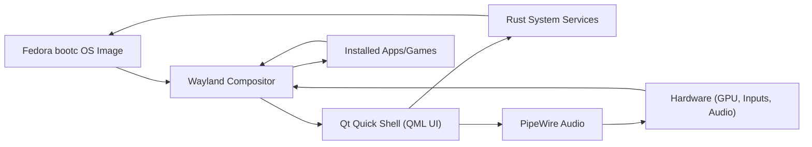

# Architectural Report: Cinematic Console UI on Fedora bootc Wayland

**Executive Summary:** This design envisions a *console-style* Linux OS (Fedora-based with `bootc` immutable images) delivering a PS5-like cinematic UI on a TV. The core is an immutable Fedora image (separate system vs mutable state), a Qt Quick (QML) shell running full-screen via Wayland, and Rust-based system services. The UI targets fluid 60 FPS animations (≈16 ms/frame), rich effects (translucency, blur, 3D-parallax, shaders) and spatial audio for immersion. A modular asset pipeline (high-res artwork, async loading, caching) serves large media assets. Input is controller-first (D-pad/analog navigation, long-press, focus rings) using Qt’s focus/Keys system. We evaluate compositor options (Weston, wlroots, QtWayland) in terms of performance and development ease. Key performance strategies include profiling (Qt’s QML Profiler), V-Sync-driven render, offloading work to WorkerScripts, and reduced-motion modes. The phased plan starts with a Phase‑0 proof-of-concept (Fedora image + minimal Qt shell) and moves through UI and service development. We specify acceptance KPIs (60 FPS, <50 ms input latency, memory/GPU budgets, load times), and list recommended tools (Qt modules, PipeWire/WirePlumber, image libs, profilers). Risks (GPU-heavy blur effects, complex audio routing, large-art memory use) are identified with mitigations. 

 *Figure:* Modern living-room gaming console UI – highlighting an immersive, blur-enhanced TV interface. The target UI must be **highly responsive and polished**, sustaining ~60 FPS (≈16.7 ms/frame). Subtle animations, ambient backgrounds and sound cues create a “cinematic” feel. UI elements (tiles, cards, dialogs) use large, high-resolution artwork scaled to each hardware tier; translucent “frosted-glass” layers use targeted blur and dimming to separate UI from background imagery. Quality/performance modes allow scaling effects (e.g. full blur on high-end GPUs, simpler effects on low-power devices). The design assumes full-screen operation (no other desktop shell), multiple user profiles (PIN-protected login), and multi-modal content (apps, media, games, streaming). 

## Animation & QML Techniques

To achieve smooth transitions, use Qt Quick’s declarative animation system with care:

- **States & Transitions:** Define named states for UI screens or panel layouts, and attach `Transition` blocks for property animations. E.g. a “home” → “settings” state change animates position/opacity of UI cards. States/transitions keep logic clear and ensure coordinated animations.
- **Behaviors:** Use `Behavior` on individual properties (like `x`, `y`, `opacity`, `scale`) for implicit animations. This auto-animates any value change without manual `start()` calls. For example, placing `Behavior on x { NumberAnimation { duration:500 }}` ensures any change to `x` is smoothly animated. (Beware conflicts if multiple animations target the same property.)
- **Property Animations:** For one-off or complex sequences, use `PropertyAnimation`, `SequentialAnimation` and `ParallelAnimation` explicitly. This gives precise control, e.g. animating a card `x` then fading it out. Coordinate using `SequentialAnimation` and `ParallelAnimation` as needed.
- **Performance Optimizations:** Avoid animating expensive properties (e.g. `width`, `height`, complex color changes) on many items simultaneously. Prefer transforms (`scale`, `rotation`) or `opacity` which are GPU-accelerated. Use `Layer.enabled: true` on static content to cache its rendered result. This captures a subtree into a texture, preventing re-rasterization every frame (at cost of VRAM).

| **QML Technique**               | **Use & Benefits**                                 | **Trade-offs / Notes**                                      |
|-------------------------------|----------------------------------------------------|--------------------------------------------------------------|
| **Behavior**                  | Auto-animates property changes (e.g. position) | Can conflict if multiple behaviors/animations target same prop; easy for simple UI motion. |
| **States & Transitions**      | Clean layout changes; animates between defined states | Requires pre-defining states; less flexible for dynamic content. |
| **PropertyAnimation**         | Explicit motion control; can group in sequences | Must manually start; overlapping animations can cancel each other. |
| **Loader / AsyncImage**       | Load QML pages or images on demand; keeps UI thread free | Initial loading delay; use placeholder or BusyIndicator for feedback. |
| **WorkerScript / Threads**    | Offload heavy logic (calculations, decoding) | Async messaging overhead; must handle thread-safety in code. |
| **Layer / ShaderEffectSource**| Cache complex (static) UI into texture | Uses extra GPU memory; update invalidates cache. For shared blurred backgrounds use `ShaderEffectSource` as a single cache. |
| **FastBlur / ShaderEffect**   | Frosted-glass background (QtGraphicalEffects) | Costly: sample count & radius must be low for performance. In Qt6 prefer custom `ShaderEffect` for better perf. |
| **QtWayland Compositor API**  | If writing a compositor in QML, use these types (QtShellSurface, etc.). | (See Wayland Compositor section.) |

For smooth animations, ensure `asynchronous: true` on any large `Image` source and enable `cache: true` on frequently used images to avoid re-decoding. Use the QML Profiler (Qt Creator) to identify bottlenecks and optimize that code.

## Sound Design

A console UI uses sound sparingly but impactfully. We separate **ambient sounds** (looped background music or environment sound) from **SFX cues** (navigation clicks, confirmation tones, alerts). Best practices from game UI design apply: 

- **Audio Hierarchy:** Assign UI SFX to their own channel or bus, distinct from ambient music/streaming audio. Mix them at different frequency ranges so important cues (e.g. error buzzers, selection clicks) stand out.
- **Feedback & Immersion:** Use short, per-action sounds (e.g. menu select, back, error) for tactile feedback. Add a subtle ambient loop (wind, low hum) to set mood without distracting.
- **Ducking:** When a high-priority UI sound plays (e.g. alert or click), temporarily lower (“duck”) the ambient audio or any overlapping track. This ensures SFX are clearly heard. For example, background music volume can be reduced by 20–30% during critical UI cues.
- **Spatialization:** For a 2D console UI, complex 3D audio is unnecessary. However, mild stereo panning (e.g. left/right for on-screen focus) can enhance depth. Use PipeWire’s mixing and per-output volume controls. Support system volume, and separate volumes for “UI” vs “media” vs “ambient” if possible.
- **Technical:** Use PipeWire/WirePlumber as the audio server for flexibility (Bluetooth, HDMI ARC, USB headsets). Define rules so plugging in a headset or switching sources does not clobber ongoing audio. Qt’s `QSoundEffect` or `QMediaPlayer` can play short clips; complex mixing can be handled via PipeWire APIs. 

Cite: UI audio should “guide players, confirm actions, and transform a simple menu into a responsive world”. Implement audio channels (navigation, notifications, ambience) with dynamic priority and ducking.

## Asset Pipeline

Games and media UIs demand high-quality art with efficient loading. Key points:

- **Artwork Resolutions:** Store artwork at a few scaled sizes (e.g. 4K, 1080p, 720p) and load the most appropriate for the current display. Use vector graphics for icons and scalable UI elements if possible. 
- **Formats & Compression:** Use efficient formats: PNG/WebP for icons, JPEG/WebP for photos. Pre-compress large images. If using Qt resource system (`.qrc`), embed frequently used assets for fast access.
- **Asynchronous Loading:** In QML use `Image { asynchronous: true }` and manage `status` to show placeholders during load. This prevents UI jank. For on-demand content (game covers, movie posters), use `Loader` or `Image` with `cache: true` once decoded.
- **Progressive & Caching:** Consider progressive loading (load a low-res thumbnail, then replace with high-res). Leverage `QQuickImageProvider` or `ShaderEffectSource` to preprocess or downscale images. Cache decoded textures when reuse is expected (but free caches if memory is tight).
- **Memory Budget:** Mobile/embedded GPUs may have limited VRAM. Avoid holding many large textures simultaneously. Release or replace off-screen content. (Pinned items like home-screen wallpaper can use `Layer.enabled: true` cache to avoid redraw costs.)
- **Custom Package Format:** If using a `.cbundle` system, allow bundling of game/artwork with automatic scaling. Base the format on OCI containers or Flatpak-like bundles to leverage existing tools. Shared libraries (e.g. audio engines) should be installed globally or via system repos, not in every bundle, to save space.

## Input & Focus Model

Controller navigation drives the UI: D-pad or left-stick to move focus, A/B (or cross/circle) to confirm/back, long-press for alternatives (e.g. details). Use Qt Quick’s focus and Keys APIs:

- **Focus Handling:** Make each interactive element (buttons, list items) focusable (`focus: true` or `focusPolicy`) and in a `FocusScope` if necessary (e.g. `ApplicationWindow`, `Pane`). Qt Quick Controls (MenuBars, Pages, etc.) have built-in focus management. Use the `Keys.onPressed` handler or `KeyNavigation` attached property to respond to arrow and button presses.
- **Focus Ring & Visuals:** Clearly highlight the focused item (e.g. glow/outline) so navigation is obvious. Maintain a logical focus order (row/column).
- **Long-Press/Repeat:** Handle `onPressed` and `onReleased` for long-press detection, possibly via a `Timer`. For scrolling, use auto-repeat on arrow hold.
- **Analog Input:** Map analog stick motions to accelerated focus movement or scrolling in lists (e.g. fast-scroll while stick held).
- **Focus Restoration:** If the UI regains focus (e.g. returning to home screen), remember the last-focused element per user.
- **Multi-User:** On login screen, disable controller input from other users, and use a locked modality for PIN entry (e.g. only numeric pad focus active).
- **Mouse/Keyboard:** Support plugged-in KB/Mouse as alternate input (Qt Quick handles these automatically).

No special citation needed; this follows standard Qt Quick input models.

## Wayland Compositor Options

We compare three approaches for the Wayland compositor (the display server) that will host the Qt shell:

| **Option**        | **Pros**                                                                                                                                                 | **Cons / Notes**                                                                                      |
|-------------------|----------------------------------------------------------------------------------------------------------------------------------------------------------|-------------------------------------------------------------------------------------------------------|
| **Weston** (ref.) | Simple, reference compositor; lightweight C implementation; multi-backend (DRM/FBDev/X11); well-tested on embedded.                         | Lacks deep Qt integration: poor support for Qt-specific features (virtual keyboard, input methods); limited plugin ecosystem. |
| **wlroots-based** | A library (C) for building compositors (used by Sway, Wayfire, etc.). Compositors are lean and high-performance: explicit DRM use, atomic modesetting. Prioritizes low input latency and modularity. Very configurable. | Requires writing a custom compositor from scratch (C/C++). High complexity: must manage inputs, outputs, surfaces manually. Lower-level debugging. |
| **QtWayland Compositor** | Built into Qt (QtWayland module). Allows writing the compositor in QML/C++ with full Qt ecosystem (QtQuick controls, virtual keyboard, IPC all work out-of-box). Optimized path: zero-copy textures (`wl_subsurface`), EGLFS-KMS for direct DRM. Sharing graphics stack between compositor and clients reduces overhead. | License is GPL3 or commercial (like Qt itself). Less example code/community than Weston/wlroots. Custom Qt compositor must be built (no existing generic shell). |

 notes that QtWayland “combines compositor and client in one stack” and optimizes rendering via direct sub-surfaces.  highlight that wlroots compositors “remain relatively small” and “prioritize minimal input latency”. Weston’s stability and minimal feature set makes it easy to use as a starting point. 

## Performance Strategies

Achieving consistent 60 FPS (≈16 ms/frame) is critical. We adopt these best practices:

- **V-Sync & Frame Budget:** By default Qt Quick syncs to display V-Sync; on a 60Hz TV, the target is 60 FPS. Avoid disabling V-Sync (which can waste CPU/GPU). 
- **Profiling:** Use the Qt Creator QML Profiler to identify slow code. Profile frequently, especially after adding effects. Most frame drops come from unexpected bottlenecks, not a wrong `frameRate` setting.
- **Offload Work:** Any heavy computation (gamepad polling, JSON parsing, network fetch) should be in a `WorkerScript` or C++/Rust thread so the main GUI thread remains free. For example, decompressing assets or scanning USB devices can run asynchronously.
- **Minimize Overdraw:** Only render what’s needed. Hide off-screen items (set `visible: false` when off-page). Avoid fullscreen alpha fading on large backgrounds.
- **Layer Usage:** Use `Layer` caching for static complex UI blocks (non-animating menus, blurred backdrops). Layer-enabled items are rendered once to texture, but avoid for constantly animating content.
- **Efficient Shaders:** Reduce blur radius and samples. Use lighter shader techniques (box blur or single-pass Gaussian) for real-time blur. If using Qt6, write a custom GLSL `ShaderEffect` for max speed. Always test on lowest-tier GPU to set effect limits.
- **Reduced-Motion / Power Modes:** Provide an option to disable non-essential animations and effects (e.g. fallback to instant mode) for low-end devices or accessibility.
- **Frame Timing:** Ensure any JavaScript or binding computation does not exceed a couple of milliseconds per frame. Never block the event loop.

## Testing Matrix

- **Virtualization (Phase‑0):** Use QEMU/KVM with virtio-gpu (virgl) to test the Fedora boot image and GUI flow. Note: virtio-gpu only approximates graphics; actual GPU driver differences (Intel Mesa vs AMD vs NVIDIA proprietary) must be tested separately.
- **Tiered Hardware:** Test on sample low-end devices (e.g. Intel NUC with iGPU, AMD/Intel integrated graphics, plus a midrange NVIDIA box). Each tier should meet baseline FPS without stutter. On the high-end tier, test 4K output and demanding effects.
- **Actual Displays:** Verify with a real HDMI TV and various audio outputs (TV speakers, AVR, Bluetooth headset). Test HDMI-CEC (if needed) and ARC/eARC audio switch cases.
- **Controllers & Input:** Use multiple controller types (gamepads, keyboards, remotes) to ensure navigation is robust. Test long-press, simultaneous button presses, reconnect events.
- **IO Devices:** Plug/unplug USB drives and discs; ensure automount or notifications work. Test hotplug drivers (game controllers, network adapters).
- **Multi-User & Security:** Simulate multiple user login/logout cycles with PINs. Test lock screen and unauthorized access attempts.
- **Software:** Run stress tests (continuously open/close apps, play media) to detect memory leaks or instability. Validate update/rollback flows in QEMU.

## Phase‑0 POC & Roadmap

**Phase‑0 (Proof of Concept):** Build and boot a minimal Fedora `bootc` image in QEMU. Validate that a simple Qt Quick “Hello World” (with a translucent overlay or blur) can run on Wayland fullscreen without a window manager. Test the immutable update/rollback mechanism (e.g. apply a minor update and roll back). Establish the Podman/KVM build workflow on development machines.

**Phase‑1 (Core Shell):** Develop the Qt Quick QML shell application: design a basic home screen with animated card layout, background image and blur overlay (using `ShaderEffectSource`+`FastBlur` as needed). Implement controller focus navigation (using `Keys`/`focus: true`). Integrate QML sound playback for SFX and an ambient loop. Use WirePlumber to route audio to default sink. 

**Phase‑2 (User Profiles & Security):** Add multi-user support: profile selector, simple PIN authentication screen. Persist profiles (Rust service for storage). Lock screen implementation and inactivity timeouts.

**Phase‑3 (Package/Repo & SDK):** Define the custom package format (e.g. `.cbundle` as OCI-based archive). Build a Rust service for package management and repository syncing. Provide an app SDK (QML templates, CLI tools) for third-party apps (news, weather, games). Launch a “store” UI to browse/install content.

**Phase‑4 (Media & Game Streaming):** Integrate media clients: embeddable players for Plex/Jellyfin (e.g. via their web APIs or native clients). Add streaming client (Moonlight for NVIDIA, Xbox Cloud UI). Implement controllers integration for these apps.

**Phase‑5 (Gaming & Drivers):** Support local games: include Mesa, Vulkan, and Wine/Proton layers. Test Steam on Linux, RetroArch emulators. Build Rust service to manage game controllers, mapping, and profile. Enable disc-drive and USB game loading.

Each phase includes integration testing on hardware. Milestones are gated: for example, don’t proceed to extensive UI animations before the base image and compositor are solid.

## Acceptance Criteria & KPIs

We define concrete metrics to measure “cinematic quality” and performance:

- **Frame Rate:** Steady 60 FPS in key scenarios (home menu, game launcher, animations) on mid-tier hardware. Occasional dips to 30 FPS allowed on lowest tier, but transitions must remain smooth. (Frame time budget ≈16 ms.)
- **Input Latency:** Controller navigation latency <50 ms end-to-end (key press to UI update) to feel instantaneous.
- **Boot/Load Times:** Shell should appear within ~5 s of boot on target hardware. App switch/launch delays ≤2 s for simple apps.
- **Resource Usage:** Idle memory footprint of the UI shell and core services should be minimal (ideally <200 MB RAM). GPU memory for UI layers should not exceed a few hundred MB on mid/high-tier GPUs; on low-tier keep under ~100 MB.
- **Audio Responsiveness:** SFX should play within ~20 ms of action (no perceivable delay). Background music must duck properly when SFX play.
- **Stability:** Update/rollback must work without corrupting user state. No crashes or freezes in daily use (MTBF measured over extended testing).
- **User Experience:** Subjective user tests should report the UI “feels smooth, modern, and immersive.” (Polish factors like animation ease-in/out, audio sync, etc.)

## Libraries, Frameworks & Tools

- **Qt Modules:** QtQuick/QML (for UI), Qt Quick Controls (if useful for standard controls), Qt Wayland Compositor (if building custom compositor), Qt Multimedia (fallback audio playback). Possibly Qt Gamepad for raw controller support, QtGraphicalEffects (Qt5) or write GLSL shaders (Qt6). 
- **PipeWire / WirePlumber:** System audio server. Use PipeWire’s API or CLI (`wpctl`) to manage volumes, routes and profiles.
- **Rendering:** Mesa (for Intel/AMD) and proprietary NVIDIA drivers (for high-end GPU). Vulkan is optional (QtQuick uses OpenGL).
- **Profiling Tools:** Qt Creator’s QML Profiler, KDE/KWin’s KWin Profiler or PerfTrace, Linux perf, Renderdoc/SwiftShader for shader debugging.
- **Input Libraries:** SDL2 or Qt Gamepad for controller input could be used, though Qt Quick’s built-in Keys handling often suffices.
- **Package Management:** `rpm-ostree` or custom container approach for system image updates. Use OCI container tools for app bundles.
- **Image Handling:** libjpeg, libpng, WebP via Qt’s image plugins. QtQuick’s `QQuickImageProvider` for dynamic image sources.
- **Sound:** libcanberra or SDL_mixer for SFX if needed; ALSA/Pulse API (through PipeWire).
- **Development:** Podman/KVM for building/testing on Windows hosts; Fedora Toolbx or Docker for CI. Use Git, CI pipelines for auto-build and QEMU smoke tests.

## Risks & Mitigations

- **Blur/Compositor Performance:** Real-time blur can cripple frame rate. *Mitigation:* Limit blur radius/samples; cache static backgrounds with `Layer.enabled`; use `ShaderEffectSource` caching for shared blur. If needed, reduce to a simple dimming+texture overlay for low-end devices.
- **Audio Routing Complexity:** Multiple audio sinks/sources (HDMI, Bluetooth, analog) can cause glitches. *Mitigation:* Predefine WirePlumber policy rules to prefer HDMI or headphone, and handle jack/BT plug events. Test all cases thoroughly.
- **Large Art & Memory:** High-res UI art and blurred textures can use much VRAM. *Mitigation:* Share caches across views (e.g. a single blurred wallpaper), and free images of off-screen apps. Provide a low-res mode.
- **Input Focus Issues:** Mismanagement of Qt focus scopes can make navigation erratic. *Mitigation:* Use Qt’s `focus` and `activeFocus` properly, and group focusable items in logical `FocusScope` elements. Test edge cases (popups, multiple windows).
- **Licensing:** QtWayland Compositor is GPLv3 unless using a commercial Qt license. If proprietary components are planned, consider keeping compositor separate or choose Weston/wlroots (MIT/BSD).
- **Reinventing Existing Components:** The spec avoids redoing services that exist. For example, use BlueZ for Bluetooth, PipeWire for audio, NetworkManager for connectivity. *Mitigation:* Leverage Fedora’s packages and upstream projects where possible rather than custom solutions.

In summary, this architecture reuses mature components (Wayland, Qt, PipeWire, Rust/C libraries) and focuses on polished UI/UX. By phasing development and measuring key metrics (FPS, latency, memory), we ensure the final console UI is as smooth and cinematic as a modern game console .

**Sources:** Qt documentation and community guides on performance, Qt Quick animation and image best practices, sound design best practices, and compositors internals were consulted to inform these recommendations.