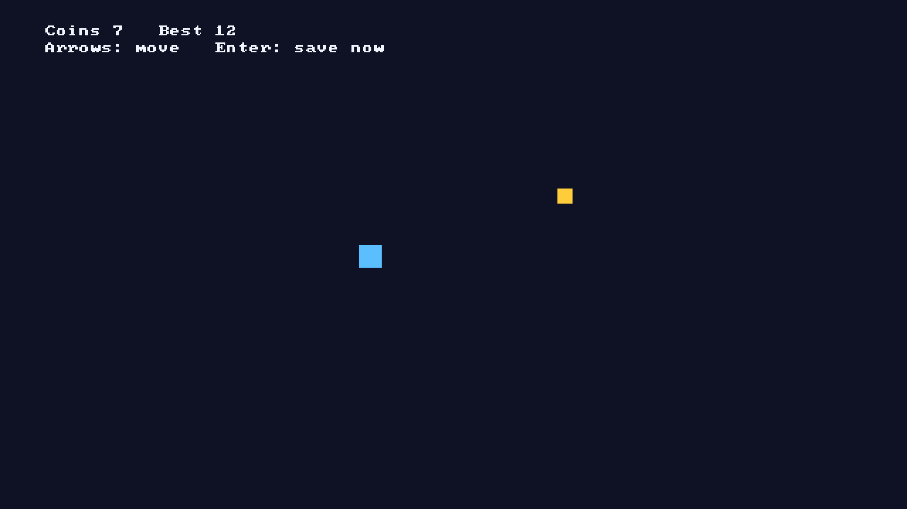

# Hello Game

A tiny game that does what the [RuyaOS developer guide](../../docs/developers/README.md) asks of one: move a square with a controller or the keyboard, collect coins, and keep the best score safe. It is meant to be copied.



| What the guide asks | Where it is here |
|---|---|
| Flatpak on the freedesktop runtime, only the permissions the game needs | `org.ruyaos.HelloGame.json` |
| AppStream with every recommended key (age rating, controller support, `x-ruya-*`) | `data/org.ruyaos.HelloGame.metainfo.xml` |
| The game is listed in the Games row (`Categories=Game;` in the desktop entry) | `data/org.ruyaos.HelloGame.desktop` |
| Controller (hot-plug, dead zone, D-pad) with keyboard fallback | `src/main.c` |
| Full screen, drawn for 1920x1080 and scaled; text 24 px or larger; nothing outside the safe area | `src/main.c` (`draw`), `src/game.h` (`SAFE_X`, `SAFE_Y`) |
| Saves in `$XDG_DATA_HOME/saves/`, written atomically with a `.bak`, loaded with a checksum and a fallback | `src/save.c`, `src/game.c` |
| `SIGTERM` saves and exits within the console's 5 seconds | `src/main.c` (`on_term`, end of `main`) |

**Why C and SDL3.** The freedesktop runtime already contains SDL 3 (and SDL 2 through `sdl2-compat`), and its SDK has the compiler, so the manifest has one module and no downloads. Python with pygame-ce was considered: the runtime does not have it, so it would need a module for pygame and for SDL. SDL is also what most game engines use for controllers, so the input code carries over.

## Licence

CC0 1.0 (public domain, SPDX `CC0-1.0`): copy any file, change it, ship it, no attribution needed. See `LICENSE`.

## Build

On Linux, or in WSL with a Fedora or Debian distribution. Once:

```sh
sudo dnf install flatpak flatpak-builder appstream
flatpak remote-add --user --if-not-exists flathub https://dl.flathub.org/repo/flathub.flatpakrepo
```

In this folder:

```sh
flatpak-builder --force-clean --user --install-deps-from=flathub --repo=repo build-dir org.ruyaos.HelloGame.json
```

The first run downloads the runtime and SDK (about 1 GB). The build runs `make test` (the save code's unit tests, no display needed), `make` and `make install`, then exports the app into the local repository `repo/`. `build-dir/`, `repo/` and `.flatpak-builder/` are ignored by git.

Check the metadata (`--no-net` skips the check that the screenshot URL exists online, which is only true once the files are published):

```sh
appstreamcli validate --no-net data/org.ruyaos.HelloGame.metainfo.xml
```

## Run it on the build machine

```sh
flatpak --user remote-add --if-not-exists --no-gpg-verify hello-local repo
flatpak --user install -y hello-local org.ruyaos.HelloGame
flatpak run org.ruyaos.HelloGame --windowed
```

`--windowed` opens a window instead of taking the whole screen (the console always runs it full screen). Arrow keys or WASD move, Enter saves, Esc quits (Esc quits only with `--windowed`: on the console B also arrives as Esc). Plug in a controller and it moves with the stick or the D-pad and `A` saves; while a controller is connected the keys are ignored for movement.

The saves are in `~/.var/app/org.ruyaos.HelloGame/data/saves/` (`slot1.sav`, and `slot1.sav.bak` after the second save). Delete that folder to start over.

## Run it on a RuyaOS machine

Pack the repository, copy it over and install it system-wide (the dev image and its SSH key are in [`docs/dev-setup.md`](../../docs/dev-setup.md); see the guide's [Getting started](../../docs/developers/getting-started.md)):

```sh
tar -czf hello-repo.tgz repo
scp -i ~/.ssh/ruyaos_dev -P 2222 hello-repo.tgz root@127.0.0.1:/root/
ssh -i ~/.ssh/ruyaos_dev -p 2222 root@127.0.0.1
# on the console:
tar -xzf hello-repo.tgz -C /root
flatpak remote-add --system --if-not-exists --no-gpg-verify hello-local /root/repo
flatpak install --system -y hello-local org.ruyaos.HelloGame
```

The game then appears in the Games row. Starting it from the shell shows its window on the profile's own Wayland socket (**experimental**, T-164; the app needs `--socket=wayland`). The scripted check is still headless: `scripts/vm-sample-check.sh` installs it, launches it for a profile through `Session1`, stops it and checks the saves.

## Take the store screenshot

`art/screenshot.png` is the game itself (headless, one frame):

```sh
flatpak run --env=SDL_VIDEODRIVER=dummy --command=sh org.ruyaos.HelloGame -c 'hello-game --screenshot $XDG_DATA_HOME/screenshot.png'
cp ~/.var/app/org.ruyaos.HelloGame/data/screenshot.png art/screenshot.png
```

`art/make-art.py` draws `hero.png` and `logo.png` (the `x-ruya-hero` and `x-ruya-logo` pictures; 1920x1080 and 640x360, 16:9). Replace all three with your own art.

## Files

```
org.ruyaos.HelloGame.json            Flatpak manifest
Makefile                             build, test, install (no tabs: recipes start with '>')
data/                                desktop entry, AppStream metainfo, icon
src/main.c                           window, input, loop, SIGTERM
src/game.c, game.h                   rules, save format (text with a CRC-32), load with fallback
src/save.c, save.h                   the atomic write
tests/test_game.c                    unit tests for the save code (no SDL)
art/                                 screenshot, hero, logo (store art)
```
